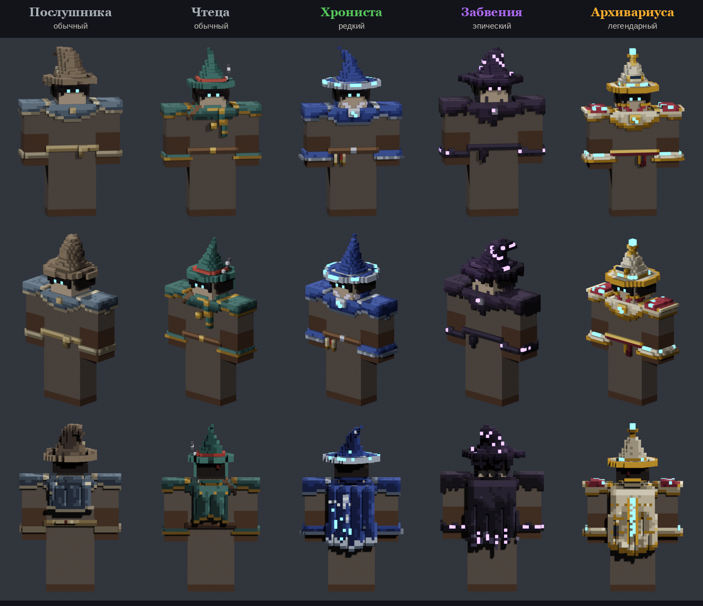
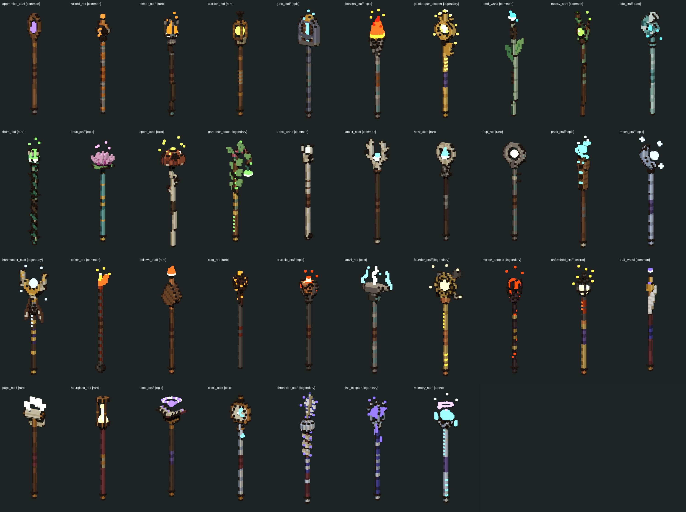

# Маг (Хронисты) — броня, мана, посохи, заклинания

Маг читает память, как книги.

* **Этап 1** — одежда мага (шляпы и лёгкие накидки с плащами) и манапул.
* **Этап 2** — 37 посохов на этажах 1–5, удары-снаряды, 19 заклинаний, 9 пассивок,
  «Барьер» (ПКМ), «Покров» (клавиша 3), дебафы, анимации каста, FX и звуки.
  Описание — [ниже](#этап-2-посохи-и-заклинания).

Выбор класса в игре — следующий этап (пока `class mage` в отладке).

## Этап 1: что в пакете

| Файл | Что |
|---|---|
| `src/ReplicatedStorage/Shared/Config/Armor.lua` | 5 комплектов мага (`class = "mage"`), слоты «Шляпа»/«Накидка», мана в предметах, новые бонусы комплекта, броня по классу (`canWear`, `pool`, `starterFor`, `slotName`) |
| `src/ReplicatedStorage/Shared/Config/MageArmorMeshData.lua` | Сгенерировано: меши шляп, накидок и плащей (формат как у брони воина) |
| `src/ReplicatedStorage/Shared/Config/Mana.lua` | Числа маны: пауза после траты, реген вне боя, цены способностей, масштаб |
| `src/ReplicatedStorage/Shared/Config/Palette.lua` | `Palette.Mana*`, `Palette.Mage` (цвета запасного облика) |
| `src/ReplicatedStorage/Shared/Voxel/HeroArmorBuilder.lua` | Подмешивает комплекты мага; у меша свой атрибут `ImportYaw` главнее папкиного |
| `src/ServerScriptService/Systems/ManaService.lua` | **Новый**: мана — максимум, реген, трата, атрибуты для HUD |
| `src/ServerScriptService/Systems/ArmorService.lua` | Броня по классу: надетое другого класса уходит в `armorStash`, сундук — только своего класса, мана в `gearStats` |
| `src/ServerScriptService/Systems/AppearanceService.lua` | Маг: шляпа/накидка из мешей, без мешей — запасной облик из Part'ов |
| `CombatService`, `InventoryService`, `EquipmentService`, `EchoService`, `DataService`, `Bootstrap` | Хук `classApplied`, мана в окне героя, пересчёт при смене посоха, сила снаряжения |
| `StarterPlayer/.../PixelHudController.lua` | Полоса маны под HP (только у мага), вспышка «не хватает маны», посох на портрете |
| `Windows/CharacterWindow.lua`, `Windows/InventoryWindow.lua` | «Шляпа»/«Накидка» у мага, строка «Мана» в карточке предмета |
| `tools/mage-armor/` | Генератор (Python), `assets/mage_armor.glb`, `AssembleMageArmor.lua`, превью в Blender |
| `tools/lua/test_mage_armor.lua` | Проверка конфигов (52 проверки) |

## Комплекты

| Набор | Редкость | Шляпа | Накидка | Бонус комплекта |
|---|---|---|---|---|
| Послушника (`novice`) | обычный, стартовый | мягкая, поникший кончик, латка | сине-серая пелерина, сумка, свиток, короткий плащ | — |
| Чтеца (`reader`) | обычный | высокая бирюзовая, лента-закладка, перо | горчичный шарф, книги на боках, плащ «ласточкин хвост» | +10 маны |
| Хрониста (`chronicler`) | редкий | синяя, серебро, руны, звёзды | высокий ворот с камнем, книга на цепочке, длинный звёздный плащ | +1 маны/с |
| Забвения (`oblivion`) | эпический | рваные поля, вуаль, фиолетовые руны и глаза | ворот из перьев, рваная пелерина, фонарь, туманный подол | рывок возвращает 12 маны |
| Архивариуса (`archivist`) | легендарный | светлая, золото, камень памяти, раскрытая книга | наплечники-переплёты, книга с камнем, тубус, плащ с золотыми строками | пока маны > 50%, −8% урона |

Ноги, кисти и почти все руки открыты — виден основной облик героя.
Под полями — тень и светящиеся глаза (у Забвения фиолетовые).



Шляпы крупно: `shots/mage_hats_closeup.png`.

## Мана

* Класс: 100 + 8 за уровень, 3 маны/с (Config/Classes).
* Броня: шляпа и накидка дают ману (растёт с ★, как здоровье) и реген; бонусы комплектов.
* Посох: `Weapons.Items[id].mana / manaRegen` (числа — `Config/LootMage.lua`, этап 2).
* Обычные удары посохом ману **не** тратят. Тратят способности: `ManaService.spend(player, n)`.
* После траты реген ждёт 0,8 с; без урона и трат 4 с — реген ×2; в хабе мана всегда полная.
* Полная мана: спавн, вход на этаж, костёр (вместе с зарядами лечения).
* Атрибуты игрока: `Mana`, `MaxMana`, `ManaRegen`, `ManaDeniedAt`.

## Установка

1. Скопировать файлы пакета поверх проекта (Rojo подхватит `src`).
2. Studio → File → Import 3D → `tools/mage-armor/assets/mage_armor.glb`, настройки не менять.
3. Command Bar (режим Edit): вставить `tools/mage-armor/AssembleMageArmor.lua` → в
   Output «готово: 77 из 77». Ctrl+S.
4. Play → Command Bar (сервер):
   ```lua
   print(game.ServerStorage.KlinokDebug.Cmd:Invoke("class mage"))
   print(game.ServerStorage.KlinokDebug.Cmd:Invoke("magearmor archivist"))
   print(game.ServerStorage.KlinokDebug.PreviewArmor:Invoke("mage"))
   print(game.ServerStorage.KlinokDebug.Cmd:Invoke("mana"))
   ```
   Без шага 2–3 маг одет в запасной облик из Part'ов (шляпа, пелерина, плащ).
   Если шляпы смотрят назад — в `AssembleMageArmor.lua` поставить `MESH_YAW = 180` и запустить снова.

## Генератор

```
cd tools/mage-armor
python3 export_mage.py                      # → assets/: glb, MageArmorMeshData.lua, палитра
cp assets/MageArmorMeshData.lua ../../src/ReplicatedStorage/Shared/Config/
blender -b -P render_mage.py -- <папка> novice reader chronicler oblivion archivist   # превью
```
Формы — `mage_sets.py` (наборы), `mage_parts.py` (поля, тулья, пелерина, плащ…),
`magekit.py` (воксели, свет по нормали, рампы). Править генератор, не Lua.


---

## Этап 2: посохи и заклинания

### Что в пакете

| Файл | Что |
|---|---|
| `Config/LootMage.lua` | **Новый**. Все числа мага: 37 посохов (пул сундуков по этажам), удары (`Items`: стиль снаряда, паттерны серии, дебаф), 12 паттернов, 23 стиля, 19 заклинаний, 9 пассивок, «Барьер», «Покров», дебафы |
| `Config/Loot.lua` | Подмешивает посохи/заклинания/пассивки; `weaponClass`, `StarterWeapons`, `newWeapon`, `rollChest(…, className)` — сундук мага даёт только посохи, сундук воина — ни одного |
| `Config/Weapons.lua` | Тип `staff`, числа посохов из LootMage |
| `Config/SfxMage.lua` | **Новый**. Звуки мага: попадания по стилю (`HitByStyle`), барьер, покров, дебафы, заклинания, варианты `mageCast1–3`; `Sfx.lua` подмешивает |
| `Config/WeaponMeshDataMage.lua` | **Новый**, сгенерирован: меши 37 посохов (+ `focus` — центр камня навершия) |
| `Net/Net.lua` | RemoteEvent `MageFx` |
| `Voxel/VoxelWeaponBuilder.lua` | Меши посохов из WeaponMeshDataMage; `BladeTip` у посоха — в `focus`; запасной воксельный посох; цвет `arcaneGlow` |
| `Systems/MageService.lua` | **Новый**. Удар посохом (снаряды по паттерну), дебафы, пассивки, «Барьер», «Покров» |
| `Systems/MageBolts.lua` | **Новый**. Полёт снарядов на сервере: самонаведение, пробивание, сплэш, осколки, цепь, навес, волна, луч, нова |
| `Systems/WeaponAbilitiesMage.lua` | **Новый**. 19 заклинаний, `PHASES` — фазы, которые видит клиент |
| `WeaponAbilities`, `AbilityService`, `MeleeService`, `CombatService`, `EnemyService`, `EquipmentService`, `EchoService`, `LootService`, `DebugCommands`, `Bootstrap.server` | Хуки (см. «Вставки» ниже) |
| `Controllers/MageFx.lua` | **Новый**. Клиент: снаряды (локальная симуляция), попадания, барьер, покров, дебафы, пассивки, аура посоха |
| `Controllers/MageSpellFx.lua` | **Новый**. Клиент: эффекты 19 заклинаний по фазам |
| `Lib/MageFxKit.lua` | **Новый**. Общие кирпичики FX: детали, свет, частицы, кольца, тряска, звук |
| `Controllers/PlayerAnimMage.lua` | **Новый**. Хват посоха, 3 удара, барьер, покров, 5 поз каста, `SPELL_ANIM` |
| `PlayerAnimator`, `CombatController`, `AbilityController`, `AttackFxController`, `PixelHudController`, `Bootstrap.client`, `StationApi` | Посох в анимациях, без рывка, «не хватает маны», слот «Покров» [3] в HUD |
| `tools/mage-weapons/` | Генератор посохов (Python), `assets/staffs_mage.glb`, `AssembleMageWeapons.lua`, `check_mage_fx.js` |
| `tools/lua/test_mage_weapons.lua` | Проверка конфигов и мешей (178 проверок) |
| `docs/shots/mage_staffs_sheet.png`, `mage_staffs_heads.png` | Превью посохов (Blender) |

### Бой мага

* **ЛКМ — удар посохом.** Серия из 3 ударов, каждый — паттерн снарядов (`single`, `twin`, `fan3/5`,
  `volley2/3`, `big`, `lob`, `lob3`, `wave`, `beam`, `nova`). Маны **не** тратит. Снаряд срывается
  с навершия на доле анимации `LootMage.StrikeAt`, мягкий автоприцел 20°. Свойства посоха:
  самонаведение, пробивание, сплэш, осколки, цепь, дебаф (у финала серии — всегда).
* **ПКМ — «Барьер»** (парирование мага): 10 маны за попытку, купол на окно парирования класса;
  удачный — +15 маны, отброс ближних врагов, снаряды врагов отражаются. Нет маны — «Не хватает маны для барьера».
* **Клавиша 1 — заклинание посоха** (эпики, легендарки, секретки). Тратит ману, сила растёт от
  максимума маны (`Mana.abilityScale`), легендарка +15% / −8% перезарядки, секретка +20% / −10%.
* **Клавиша 3 — «Покров»**: 25 маны, 3 с невидимости (враги теряют цель), перезарядка 12 с;
  первый удар или заклинание из покрова ×1,5 и снимает покров.
* **Дебафы**: горение, яд (% от урона удара в секунду), замедление, раскол брони. На враге не больше двух.

### Посохи

Числа — `Config/LootMage.lua` (`Items` и `Weapons`). Звёзды эха, заточка и бонусы — как у оружия воина.

| Эт. | Посох | Редкость | Снаряд | Серия | Заклинание | Пассивка |
|---|---|---|---|---|---|---|
| 1 | Посох послушника (`apprentice_staff`, стартовый) | обычный | arcane | single, single, twin | | |
| 1 | Ржавый жезл (`rusted_rod`) | обычный | rust | single, single, big | | |
| 1 | Посох углей (`ember_staff`) | редкий | ember | single, twin, fan3 | | |
| 1 | Жезл дозорного (`warden_rod`) | редкий | light | single, single, volley3 | | |
| 1 | Посох Заставы (`gate_staff`) | эпический | gate | single, twin, fan3 | Сторожевой круг | |
| 1 | Маячный посох (`beacon_staff`) | эпический | fire | single, single, big | Сигнальный огонь | |
| 1 | Скипетр Привратника (`gatekeeper_scepter`) | легендарный | light | single, twin, fan5 | Врата света | Резонанс ключа |
| 2 | Камышовый жезл (`reed_wand`) | обычный | water | single, twin, twin | | |
| 2 | Замшелый посох (`mossy_staff`) | обычный | poison | single, single, lob | | |
| 2 | Посох прилива (`tide_staff`) | редкий | water | single, single, wave | | |
| 2 | Терновый жезл (`thorn_rod`) | редкий | thorn | fan3, fan3, fan5 | | |
| 2 | Посох лотоса (`lotus_staff`) | эпический | lotus | single, twin, fan3 | Цветение лотоса | |
| 2 | Споровый посох (`spore_staff`) | эпический | spore | single, volley2, lob3 | Грибница | |
| 2 | Посох Садовницы (`gardener_crook`) | легендарный | thorn | fan3, twin, fan5 | Сад шипов | Роса |
| 3 | Костяной жезл (`bone_wand`) | обычный | bone | single, single, big | | |
| 3 | Рогатый посох (`antler_staff`) | обычный | spirit | twin, twin, fan3 | | |
| 3 | Посох воя (`howl_staff`) | редкий | spirit | single, single, wave | | |
| 3 | Жезл ловчего (`trap_rod`) | редкий | bone | lob, lob, lob3 | | |
| 3 | Посох стаи (`pack_staff`) | эпический | spirit | single, twin, volley3 | Призрачная стая | |
| 3 | Лунный посох (`moon_staff`) | эпический | moon | single, twin, beam | Охотничья луна | |
| 3 | Посох Королевского ловчего (`huntmaster_staff`) | легендарный | moon | twin, fan3, volley3 | Последняя охота | Метка ловчего |
| 4 | Жезл-кочерга (`poker_rod`) | обычный | fire | single, single, twin | | |
| 4 | Посох мехов (`bellows_staff`) | редкий | fire | fan3, fan3, wave | | |
| 4 | Шлаковый жезл (`slag_rod`) | редкий | slag | lob, lob, lob3 | | |
| 4 | Посох тигля (`crucible_staff`) | эпический | magma | single, twin, big | Огненный дождь | |
| 4 | Наковальный жезл (`anvil_rod`) | эпический | lightning | single, single, volley3 | Кованая молния | |
| 4 | Посох Основателя (`founder_staff`) | легендарный | forge | twin, fan3, big | Сердце горна | Закалка |
| 4 | Расплавленный скипетр (`molten_scepter`) | легендарный | magma | single, lob, lob3 | Звезда горна | Угли |
| 4 | Незаконченный посох (`unfinished_staff`) | секретный | forge | fan3, volley3, beam | Первая плавка | Жар отливки |
| 5 | Перо-жезл (`quill_wand`) | обычный | ink | single, volley2, volley3 | | |
| 5 | Посох страниц (`page_staff`) | редкий | page | fan3, fan3, fan5 | | |
| 5 | Жезл песочных часов (`hourglass_rod`) | редкий | sand | single, twin, beam | | |
| 5 | Посох фолианта (`tome_staff`) | эпический | arcane | single, fan3, big | Раскрытая книга | |
| 5 | Часовой посох (`clock_staff`) | эпический | time | volley2, twin, nova | Остановка времени | |
| 5 | Посох Хрониста (`chronicler_staff`) | легендарный | ink | twin, fan3, beam | Строка судьбы | Сноска |
| 5 | Чернильный скипетр (`ink_scepter`) | легендарный | ink | single, lob, big | Чёрная клякса | Клякса |
| 5 | Посох Памяти (`memory_staff`) | секретный | memory | twin, fan5, beam | Вспомнить всё | Эхо |



Крупно — навершия: `shots/mage_staffs_heads.png`.

### Заклинания (клавиша 1)

Мана / перезарядка (с) / каст (с) — базовые, до бонусов редкости. Проценты — доли силы заклинания
(урон посоха × ★ эха × бонус редкости × масштаб маны × засада из «Покрова»).

| Заклинание (`id`) | Посох | Мана | КД | Каст | Что делает |
|---|---|---|---|---|---|
| Сторожевой круг (`ward_circle`) | Посох Заставы | 30 | 14 | 0,6 | Круг рун R7 на 4 с: вспышка 120% и отброс, затем 25% каждые 0,5 с и замедление 30% |
| Сигнальный огонь (`signal_fire`) | Маячный посох | 32 | 14 | 0,5 | Огненный маяк летит вперёд: взрыв 180% R5 с горением, столб огня 3 с бьёт 30% каждые 0,5 с |
| Врата света (`light_gate`) | Скипетр Привратника | 40 | 16 | 0,9 | Врата из света в 8 стадах: волна 260% на 18 стадов с оглушением 1 с, затем обрушение 120% R6 |
| Цветение лотоса (`lotus_bloom`) | Посох лотоса | 32 | 15 | 0,6 | Лотос R6 у ног: гейзер 160% с подбросом, 8 лепестков-самонаводов по 30%; лечит 12% здоровья |
| Грибница (`mycelium`) | Споровый посох | 30 | 13 | 0,5 | 6 самонаводящихся спор по 45% с ядом; где споры падают, через 1 с лопаются грибы: 35% R2,5 |
| Сад шипов (`thorn_garden`) | Посох Садовницы | 42 | 16 | 0,8 | Три кольца шипов R3/R6/R9 по 110% с ядом и корнями, затем сад 3 с: замедление 40% и 20% каждые 0,5 с |
| Призрачная стая (`spirit_pack`) | Посох стаи | 34 | 15 | 0,6 | 4 призрачных волка рвутся к врагам: укус 70% и замедление, второй укус 40% |
| Охотничья луна (`hunters_moon`) | Лунный посох | 36 | 16 | 0,7 | Луна над полем боя: 8 лунных лучей по 60% в радиусе 12, затем серп-волна 100% R8 |
| Последняя охота (`last_hunt`) | Посох Королевского ловчего | 45 | 18 | 1,0 | Метки на 8 врагах в R16, 12 призрачных соколов по 55%; отмеченные получают +20% урона 5 с |
| Огненный дождь (`fire_rain`) | Посох тигля | 36 | 15 | 0,7 | Круг R10 впереди: 8 метеоров за 2 с, каждый 70% R3 с горением |
| Кованая молния (`forged_lightning`) | Наковальный жезл | 34 | 14 | 0,5 | Молния с неба 180% в ближайшего врага и цепь на 6 целей (−15% за прыжок), оглушение 0,4 с |
| Сердце горна (`forge_heart`) | Посох Основателя | 45 | 17 | 1,0 | Разлом на 16 стадов: 5 огненных столбов по 120% с подбросом, стена огня 3 с — 25% каждые 0,5 с |
| Звезда горна (`meteor`) | Расплавленный скипетр | 48 | 18 | 1,1 | Круг R8 и гигантский метеор через 1 с: 380% (к краю 60%) с отбросом, лава R5 3 с — 25% каждые 0,5 с |
| Первая плавка (`first_cast`) | Незаконченный посох | 55 | 20 | 1,4 | Круг R14: 8 разломов с лучами по 120%, затем сверхновая 300% (к краю 50%) с горением и подбросом |
| Раскрытая книга (`open_tome`) | Посох фолианта | 34 | 15 | 0,8 | Над магом раскрывается фолиант: 12 самонаводящихся глифов по 40%, затем буря страниц 80% R6 |
| Остановка времени (`time_stop`) | Часовой посох | 38 | 18 | 0,6 | Циферблат R10: враги замирают на 2 с (боссы 0,8 с), затем удар стрелок 200% |
| Строка судьбы (`fate_line`) | Посох Хрониста | 44 | 17 | 0,9 | Строка письмен на 20 стадов: через 0,8 с вспыхивает лучом 300%, цели уязвимы (+15%) 4 с |
| Чёрная клякса (`ink_hole`) | Чернильный скипетр | 46 | 18 | 0,9 | Клякса в 12 стадах становится воронкой R9: 2 с стягивает и бьёт 15% каждые 0,25 с, затем взрыв 260% R6 |
| Вспомнить всё (`total_recall`) | Посох Памяти | 55 | 20 | 1,4 | 3 эха мага бьют лучами (2 залпа по 90%), затем шторм 16 сфер памяти по 45% в радиусе 12 |

### Пассивки

| Пассивка (`id`) | Посох | Что делает |
|---|---|---|
| Резонанс ключа (`key_resonance`) | Скипетр Привратника | Каждое 3-е попадание по врагу: разряд 60% в цель и дуги ещё в 2 врагов рядом |
| Роса (`dew`) | Посох Садовницы | Попадания копят росу; 6 капель — лечение 5% здоровья и +8 маны |
| Метка ловчего (`hunter_mark`) | Посох Королевского ловчего | Попадание метит врага на 6 с: +15% урона снарядами, каждое 4-е — пикирующий сокол 80% |
| Закалка (`tempering`) | Посох Основателя | Попадания греют посох (+2% урона за деление, до 10); на 10 — взрыв 120% R3,5 |
| Угли (`embers`) | Расплавленный скипетр | Горящие враги при смерти взрываются: 60% R4 и поджог соседей |
| Жар отливки (`casting_heat`) | Незаконченный посох | Каждый 5-й снаряд — расплавленная капля: взрыв 120% R3 с горением |
| Сноска (`footnote`) | Посох Хрониста | Каждое 4-е попадание оставляет сноску: через 1,5 с она повторяет 60% удара |
| Клякса (`blot`) | Чернильный скипетр | 25% попаданий — лужа чернил R2,5 на 3 с: 10% каждые 0,5 с и замедление 20% |
| Эхо (`echo`) | Посох Памяти | Каждый выстрел через 0,35 с повторяет эхо — 40% урона |

### Как устроены эффекты

* **Урон считает только сервер** (`MageService`, `MageBolts`, `WeaponAbilitiesMage`). Клиентам он шлёт
  `Net.MageFx` с полем `kind`: `bolt` (вылет снаряда: стиль, скорость, самонаведение, навес), `boltHit`,
  `boltEnd`, `chain`, `wave`, `beam`, `nova`, `barrier`, `veil`, `debuff`, `heal`, `passive`, `spell`.
* **`MageFx`** (клиент) симулирует снаряды локально по тем же числам, что и сервер, — по сети идёт одно
  событие на выстрел, а не позиции каждый кадр. `boltHit`/`boltEnd` гасят снаряд там, где его остановил сервер.
* **`MageSpellFx`** рисует заклинания по фазам: сервер шлёт `kind = "spell"` с `phase` из
  `WeaponAbilitiesMage.PHASES` (например, `meteor`: `cast` → `impact` → `end`), клиент держит обработчик на каждую фазу.
* **`MageFxKit`** — общие кирпичики (Neon-детали, свет, частицы, кольца, тряска камеры, звук). Всё
  временное чистится через Debris, звуки идут через шину `sfx` (`Config/SfxMage.lua`).
* `check_mage_fx.js` сверяет это всё без Studio: фазы сервера ↔ обработчики клиента, `kind` ↔ `MageFx.HANDLERS`,
  `SPELL_ANIM`, звуки.

### Установка этапа 2

1. Обновить `src` (Rojo sync) — все файлы из таблицы «Что в пакете».
2. **File → Import 3D →** `tools/mage-weapons/assets/staffs_mage.glb`, настройки не менять. В Workspace
   появится модель `staffs_mage` (111 MeshPart).
3. Command Bar, режим **Edit** (не Play): вставить весь `tools/mage-weapons/AssembleMageWeapons.lua`.
   В Output: `[AssembleMageWeapons] готово: 111 из 111 MeshPart …`. Модель импорта удаляется сама.
4. **Ctrl+S** — папка `ReplicatedStorage.WeaponMeshes` живёт только в файле места.
5. Если посох в руке смотрит навершием назад — у папки `WeaponMeshes` атрибут `ImportYaw = 180`.

Без мешей всё тоже работает: `VoxelWeaponBuilder` строит запасной воксельный посох.
Броня этапа 1 ставится так же (`mage_armor.glb` → `AssembleMageArmor.lua`, раздел «Установка» выше).

### Проверка

```bash
LUAU=/путь/к/luau node tools/run-luau.js tools/lua/test_mage_weapons.lua   # 178 проверок
LUAU=/путь/к/luau node tools/run-luau.js tools/lua/test_mage_armor.lua     # 52 проверки
node tools/mage-weapons/check_mage_fx.js                                   # 293 проверки FX
```

В Play (отладочные команды, `docs/STUDIO_DEBUG_COMMANDS.md`): `class mage` → `nocd on` → `mana full` →
`staff <id|заклинание>` → ЛКМ / ПКМ / клавиша 1; `veil` — «Покров» без маны и перезарядки;
`staff floor4` — все посохи этажа в рюкзак, `staff all` — все 37.

### Генератор посохов

`tools/mage-weapons/` — Python 3 (numpy, Pillow), воксельные модели как у оружия воина
(`vox.py`, `weapons3d.py`, `weapons3d_common345.py` — общая база).

* `staffs_common.py` — детали: древко, обмотки, кольца, наконечник, сферы, кристаллы, зубцы, чаши, пламя, листья, клетки.
* `staffs_f1.py … staffs_f5.py` — посохи по этажам (функция на посох, + `FOCUS` — центр камня, `GUARD` — хват).
* `staffs3d.py` — реестр 37 посохов; `export_staffs.py` — сборка: OBJ/MTL/GLB, палитра, свечение, `WeaponMeshDataMage.lua`.

```bash
cd tools/mage-weapons
python3 export_staffs.py assets                    # все посохи → assets/
python3 export_staffs.py /tmp/t memory_staff       # только перечисленные
cp assets/WeaponMeshDataMage.lua ../../src/ReplicatedStorage/Shared/Config/
BLENDER=/путь/к/blender ./prev.sh /tmp/sheet.png 10                       # лист превью
ORTHO=3.6 HEAD=1.5 CW=260 CH=280 BLENDER=… ./prev.sh /tmp/heads.png 10   # навершия крупно
```

После перегенерации — снова Import 3D + `AssembleMageWeapons.lua` (повторный запуск безопасен).

### Вставки для версии 345 (только описание)

Пакет собран на текущей базе. Если переносить в ветку 345 руками — вот все точки, куда мага надо подключить
(новые файлы берутся как есть):

**Сервер**
* `AbilityService` — `hooks.slot3` (клавиша 3 → «Покров»), экспорт `cooldownLeft` / `startCooldown`.
* `CombatService` — `hooks.classApplied` (мана при смене класса), `hooks.parryGate` (ПКМ мага = «Барьер», отказ с `reason = "no-mana"`).
* `MeleeService` — при `typeId == "staff"` удар уходит в `MageService.rangedAttack` вместо ближнего удара.
* `EnemyService` — враги не видят цель с атрибутом `VeiledUntil` («Покров»).
* `EquipmentService` — запрет чужого класса (`wrong-class`), `ManaService.recalc` после смены экипировки, `ensureClassWeapon`.
* `EchoService` — эхо только своего класса; мана учитывается в силе.
* `LootService` — `rollChest(…, className)`.
* `WeaponAbilities` — `install` из `WeaponAbilitiesMage`, мердж `CASTS`.
* `Bootstrap.server` — `MageService.start()`.

**Общие**
* `Net` — RemoteEvent `MageFx`.
* `Sfx` — подмешать `SfxMage`; `Weapons` / `Loot` — подмешать `LootMage`.
* `VoxelWeaponBuilder` — мердж `WeaponMeshDataMage`, `BladeTip` = `focus`.

**Клиент**
* `PlayerAnimator` — `PlayerAnimMage` (хват, удары, барьер, касты).
* `CombatController` — у посоха без рывка вперёд; сообщение «не хватает маны».
* `AbilityController` — слот 3, анимации каста.
* `AttackFxController` — пропуск следа удара у `staff`.
* `PixelHudController` — слот класса [3].
* `Bootstrap.client` — контроллер `MageFx`.
