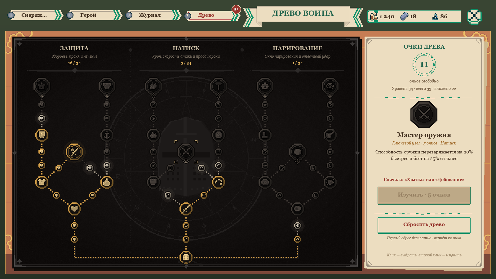
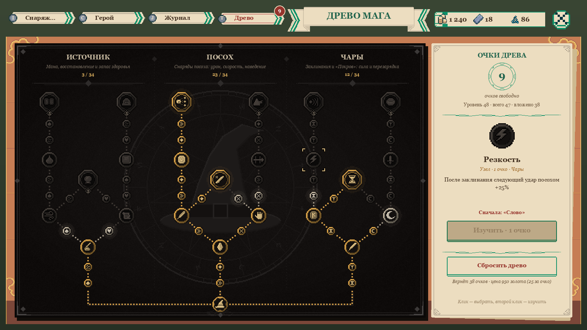

# Древо талантов (v2) и ребаланс врагов

Приложение В плана, вторая версия. Игрок видит **одно древо — своего класса**:
«Древо воина» или «Древо мага». В v1 «Страж», «Клинок» и «Бастион» выглядели как
отдельные классы, хотя это были ветки воина. Теперь это три **пути** одного древа
с понятными именами:

| Класс | Путь 1 | Путь 2 | Путь 3 |
|---|---|---|---|
| Воин | **Защита** (в плане «Страж») — здоровье, броня, лечение | **Натиск** («Клинок») — урон, скорость атаки, пробой | **Парирование** («Бастион») — окно, контратака, отражение |
| Маг | **Источник** — мана, восстановление, запас здоровья | **Посох** — снаряды: урон, скорость, наведение, пробитие | **Чары** — заклинания и «Покров» |

В каждом пути 22 узла: **14 малых** (1 очко), **5 узлов** (1 очко) и **3 ключевых**
(5 очков). Путь стоит **34** очка, древо **102**. Уровень поднят до **60**, очко
даётся за каждый уровень после первого, поэтому на 60-м у героя **59 очков**. Этого
хватает на один путь целиком и почти весь второй (без двух ключевых узлов на
концах). Все узлы пассивные: активные умения дают оружие и души боссов.




Превью собирает `python3 tools/talents/preview_talents.py`. Скрипт берёт древо из
`Config/Talents.lua` (через `tools/talents/dump_talents.lua`), раскладку из
`TalentPage` и тот же арт. На картинках воин 34-го уровня и маг 48-го уровня.

## Как это работает в игре

* **Открыть.** Клавиша **T** или закладка «Древо» в книге героя. Лента
  называется по классу: «ДРЕВО ВОИНА» или «ДРЕВО МАГА». Если есть свободные очки,
  на закладке висит печать с их числом.
* **Уровни и очки.** `очки = уровень − 1`, потолок уровня 60 (`Classes.MaxLevel`).
  Статы героя (здоровье, броня, урон оружия, мана) растут **только до 30-го**
  (`Classes.StatLevel`). С 31-го по 60-й уровень даёт только очко древа, иначе
  герой обгонял бы врагов этажей. На 30-м уровне у героя 29 очков, на 60-м 59.
  Опыт идёт по прежней формуле `100 × уровень`: путь 30 → 60 примерно в 3 раза
  длиннее, чем 1 → 30.
* **Изучить.** Наведение показывает карточку узла, клик выбирает узел, второй клик
  или кнопка «Изучить · N очко» изучает его. Узел открывается, когда изучен
  любой из его предшественников. Вход в путь — малый узел внизу (a1).
* **Сбросить.** Сбрасывается всё древо, только в долине. Первый сброс бесплатный,
  дальше 25 золота за очко, минимум 50. Кнопку надо нажать ещё раз за 3 с.
* **Классы.** Узлы хранятся отдельно для каждого класса (`profile.talents[класс]`),
  уровень общий.
* **Переход с v1.** В записи древа хранится `version`. Если она не равна
  `Talents.Version` (2), `TalentMods.entry` снимает старые узлы, и очки
  возвращаются **бесплатно**. Счётчик сбросов не тратится. Старые сохранения не
  ломаются.

### Раскладка пути (снизу вверх)

```
   K2           K3      ← ключевые концов (5 очков)
   l6           r6
   l5           r5
   N4           N5
   l4    K1     r4      ← K1: ключевой середины, нужен l2 ИЛИ r2
   l3  l2  r2   r3
   N2           N3
     l1      r1
         N1
         a2
         a1             ← вход в путь
        (печать класса — корень древа)
```

`a1 → a2 → N1`, дальше путь расходится на левую и правую стороны: `N1 → l1 → N2`,
`N1 → r1 → N3`. В центр ведут `N2 → l2` и `N3 → r2`, а от любого из них открывается
`K1`. По краям пути идут цепочки `N2 → l3 → l4 → N4 → l5 → l6 → K2` и
`N3 → r3 → r4 → N5 → r5 → r6 → K3`. Раскладка, порядок и зависимости лежат в
`Talents.Layout`, `Talents.Order` и `Talents.Needs`, они общие для всех путей.

### Малые узлы

Малых узлов в пути три вида: A × 5, B × 5 и C × 4 (`Talents.MinorPattern`). Каждый
вид — слабая доля одного из главных статов пути, примерно ¼ обычного узла.
Например, «Крепкое тело» даёт +1,5% здоровья, а «Закалка» +6%. Подписи малым
узлам не нужны: на листе у них маленький кружок с глифом 7×7, а имя и число
показывает карточка.

| Путь | A (×5) | B (×5) | C (×4) |
|---|---|---|---|
| Защита | Крепкое тело: +1,5% здоровья | Заклёпки: +1 броня | Перевязка: заряд лечит +1% |
| Натиск | Заточка: +1,5% урона оружия | Хватка: +1% скорости атаки | Добивание: 3-й удар комбо +3% |
| Парирование | Внимание: окно +0,005 с | Ответ: контратака +0,03 к множителю | Лёгкие ноги: +1% скорости бега |
| Источник | Капля чернил: +2% маны | Вдох: +0,15 маны/с | Плотная мантия: +1,5% здоровья |
| Посох | Лёгкость: снаряды +3% скорости | Заряд: +1,5% урона посоха | Меткость: +1% шанса крита (×1,5) |
| Чары | Беглость: перезарядка заклинаний −1,5% | Слово: +2% урона заклинаний | Тень: перезарядка «Покрова» −0,25 с |

### Оформление

* **Мрачный пиксельный стиль, один цвет.** Весь арт в оттенках серого, цвет
  задаёт `ImageColor3`. Изученный узел золотой, доступный цвета кости (мягко
  дышит свечение), узел, на который не хватает очков, пепельный, закрытый
  тёмный. Пунктир связей тех же тонов: тёмный — путь закрыт, кость — следующий
  шаг открыт, золото — путь изучен.
* **Иконки меньше.** Арт показывается ×2 вместо ×3. На экране малый узел 26 px,
  обычный 46 px, ключевой 58 px (восьмигранник с ромбом цены). Иконки 16×16, глифы
  малых узлов 7×7. Ромб с ценой есть только у ключевых узлов, подписей под
  узлами нет.
* **Фон** — тёмный лист 1120×748 (арт 560×374 ×2). По центру печать класса с
  фирменным предметом: **шлем** у воина, **шляпа колдуна** у мага и **клинок**
  у ассасина (фон заготовлен на будущее, древа ассасина пока нет). Ещё на фоне
  разделители путей, шапки и ствол от печати вниз. Внизу корень древа: печать
  с тем же предметом, от неё к входу каждого пути идёт ломаный пунктир.
* **Шапка пути:** имя заглавными, описание, «N / 34».
* **Карточка справа:** рамка узла, имя, «Малый узел / Узел / Ключевой узел · N
  очко · путь», описание, статус или причина отказа, «Изучить», «Сбросить древо».
  С 30-го уровня внизу подсказка «После 30-го уровня — только очки древа».
* При изучении пунктир «наливается» золотом, всплывает «+ Имя», звучит звук
  (у ключевого — звук ковки).
* Пока PNG не загружены, вкладка рисует заглушки (кружки и буквы). Всё работает,
  только без картинок.

## Древо воина

Узлы и ключевые узлы (малые — в таблице выше). **План** — как в плане,
**изменено** — число поменялось после проверки баланса (в скобках число из плана).

| Путь | Слот | Узел | Очки | Эффект | Статус |
|---|---|---|---|---|---|
| Защита | N1 | Закалка | 1 | +6% максимального здоровья | план |
| Защита | N2 | Латы | 1 | +3 брони | план |
| Защита | N3 | Выносливость | 1 | Заряд лечения лечит 40% вместо 35% | план |
| Защита | K1 | Ответный удар | 5 | После полученного урона следующая атака **+50%**, перезарядка **4 с** | изменено (+30%, 6 с) |
| Защита | N4 | Щитовая стена | 1 | +4 брони и +4% здоровья | план |
| Защита | N5 | Стойкость | 1 | Дебафы на герое −20% | план |
| Защита | K2 | Живая крепость | 5 | +1 броня за 3 стака душ мобов, до +10 | план |
| Защита | K3 | Несгибаемый | 5 | Раз за забег смертельный удар оставляет 1 HP и даёт 2 с неуязвимости | план |
| Натиск | N1 | Острый клинок | 1 | +6% урона оружия | план |
| Натиск | N2 | Быстрая рука | 1 | +5% скорости атаки | план |
| Натиск | N3 | Размах | 1 | Третий удар комбо +15% | план |
| Натиск | K1 | Мастер оружия | 5 | Способность оружия: перезарядка −20%, урон +25% | план |
| Натиск | N4 | Сила душ | 1 | Каждый стак душ ещё +0,2% урона, до +8% | план |
| Натиск | N5 | Точный удар | 1 | **+15%** урона по оглушённым | изменено (+8%) |
| Натиск | K2 | Боевой раж | 5 | После убийства **+15%** скорости атаки на **5 с** | изменено (+10% на 4 с) |
| Натиск | K3 | Разрушитель | 5 | Удар снижает броню врага на 1, **до 6** стаков, 4 с | изменено (до 8) |
| Парирование | N1 | Чуткость | 1 | Окно парирования +0,03 с | план |
| Парирование | N2 | Быстрый щит | 1 | Пауза после промаха 0,8 с вместо 1,0 | план |
| Парирование | N3 | Щитовой удар | 1 | Оглушение после парирования +0,3 с | план |
| Парирование | K1 | Отражение | 5 | Отражённый снаряд наносит ×2 урона | план |
| Парирование | N4 | Опора | 1 | После парирования +10% скорости бега на 3 с | план |
| Парирование | N5 | Контратака | 1 | Удар после парирования ×2,2 вместо ×2,0 | план |
| Парирование | K2 | Железная воля | 5 | После парирования **+15** брони на **4 с** | изменено (+25 на 5 с) |
| Парирование | K3 | Эхо щита | 5 | Парирование оглушает врагов в радиусе 4 на **1 с**, кроме боссов | дополнено |

Узлы воина те же, что в v1: поменялись слоты (R → N), цена ключевых (3 → 5) и
имена путей. Добавились малые узлы.

## Древо мага

В v1 у мага были зеркала узлов воина (броня, лечение, окно барьера, комбо). В v2
маг играет **своими механиками**: мана, снаряды посоха (скорость, дальность,
наведение, пробитие, раскол, крит) и заклинания. **Новое** — узлов в плане не было,
**план** / **изменено** — ключевые узлы из плана.

| Путь | Слот | Узел | Очки | Эффект | Статус |
|---|---|---|---|---|---|
| Источник | N1 | Запас чернил | 1 | +8% максимальной маны | новое |
| Источник | N2 | Ровное дыхание | 1 | +0,6 маны в секунду | новое |
| Источник | N3 | Тонкие поля | 1 | Заклинания на 10% дешевле | новое |
| Источник | K1 | Глубокий колодец | 5 | **+60** маны | изменено (+40) |
| Источник | N4 | Второе дыхание | 1 | Пока маны < 25%, она восстанавливается вдвое быстрее | новое |
| Источник | N5 | Конспект | 1 | Убийство возвращает 5 маны | новое |
| Источник | K2 | Эхо заклинаний | 5 | Каждое четвёртое заклинание бесплатно | план |
| Источник | K3 | Плащ забвения | 5 | Когда «Покров» спадает — щит на 15% здоровья на 4 с | план |
| Посох | N1 | Огранка | 1 | +6% урона посоха | новое |
| Посох | N2 | Лёгкий снаряд | 1 | Снаряды на 15% быстрее и на 10% дальше | новое |
| Посох | N3 | Беглый жест | 1 | +5% скорости ударов посохом | новое |
| Посох | K1 | Пробивающий луч | 5 | Удары и заклинания игнорируют 5 брони врага | план |
| Посох | N4 | Наводка | 1 | Снаряды доворачивают к ближайшему врагу (90°/с) | новое |
| Посох | N5 | Насквозь | 1 | Снаряд пробивает ещё одного врага (по нему 60% урона) | новое |
| Посох | K2 | Расщепление | 5 | Каждое 4-е попадание раскалывает снаряд на 3 осколка по 40% | новое |
| Посох | K3 | Отражатель | 5 | Отражённые барьером снаряды ×1,5 | план |
| Чары | N1 | Скоропись | 1 | Заклинания читаются на 15% быстрее | новое |
| Чары | N2 | Сила слова | 1 | +8% урона заклинаний | новое |
| Чары | N3 | Тихий уход | 1 | Перезарядка «Покрова» −2 с | новое |
| Чары | K1 | Быстрое чтение | 5 | Перезарядки заклинаний и «Покрова» −15% | план |
| Чары | N4 | Резкость | 1 | После заклинания следующий удар посохом +25% | новое |
| Чары | N5 | Тихий шаг | 1 | Удар или заклинание из «Покрова» **×1,7** вместо ×1,5 | изменено (×1,8) |
| Чары | K2 | Резонанс | 5 | **+20%** урона заклинаний | изменено (+10%) |
| Чары | K3 | Безмолвие | 5 | «Покров» 5 с вместо 3 | план |

Детали механик снарядов:
* **Скорость и дальность** умножают скорость и время полёта снаряда посоха
  (весь путь «Посох»: +30% скорости, +10% дальности).
* **Наводка.** Посохи без наведения получают доворот 90°/с. У посохов, которые и
  так наводятся, берётся большее из двух значений.
* **Насквозь.** +1 пробитие сверх родного пробития посоха. Урон 60% получает
  только враг, пробитый за счёт таланта, родное пробитие не ослабляется.
* **Расщепление.** Раскалывается каждое 4-е попадание. Осколки сами не
  раскалываются и не получают пробитие от древа, снаряды эха не раскалываются.
  Если у посоха уже есть свой раскол, к нему добавляется ещё 2 осколка, а веер
  становится на 20° шире.
* **Крит** (малые узлы «Меткость», ×1,5 урона, до 4% шанса за весь путь)
  бросается, только если не сработал крит от эха оружия. Два крита не
  складываются.
* **Второе дыхание** удваивает реген, пока маны меньше 25% от максимума
  (`ManaService.LowShare`).
* **Резкость.** Заклинание ставит заряд (атрибут `TalentEmpower`), следующий удар
  посохом его тратит. Заряды не копятся.

## Проверка баланса узлов

Броня работает так: `урон / (1 + 0,06 × броня)`.

* **Цены 1 / 1 / 5.** Малый узел даёт примерно ¼ обычного, за то же очко. Он
  дешёвый шаг, а не главная награда. Ключевой узел стоит 5 (в v1 — 3), потому
  что даёт +15–25% к своей стороне билда или новую механику. Теперь это веха, а
  не очевидный первый выбор.
* **Полный путь.** Защита целиком: +17,5% здоровья, +12 брони, заряд лечит 44%,
  дебафы −20% и три ключевых. Натиск: +13,5% урона, +10% скорости атаки, третий
  удар +27%. Посох мага: +13,5% урона, снаряды +30% быстрее, 4% крита, наводка,
  пробитие и раскол. Чары: перезарядки −22,5%, урон заклинаний +38%, «Покров»
  −3 с.
* **Уровень 60.** Статы растут до 30-го, после этого растёт только древо: 59
  очков = путь целиком (34) + 25 во втором. На 25 очков во втором пути берутся
  все малые узлы, все узлы и K1, а оба ключевых конца уже нет (24 + 1 очко в
  третий путь). Так у героя на 60-м есть «главный» путь и «побочный», а
  выбор ключевых остаётся выбором.
* **Расщепление** (новое). 3 осколка × 40% = +120% урона попадания раз в 4
  попадания. Если в цель попадают 1–2 осколка, это около +10–20% урона посоха по
  толпе, против одиночной цели меньше. Вровень с «Резонансом» и «Мастером
  оружия».
* **Насквозь** (60% по второму врагу) и **Наводка** (90°/с, мягче, чем у посохов с
  родным наведением) — удобство и урон по толпе, цена обычного узла.
* **Резкость** +25% к одному удару после заклинания. При заклинании раз в 4–6 с
  и 2–3 ударах посоха в секунду это около +3–4% урона посоха, как у обычного
  узла.
* **Тихий шаг** ×1,8 → ×1,7. В v1 это был ключевой узел, в v2 он стал обычным
  (1 очко вместо 5), поэтому бонус уменьшен с +30% до +20%. «Покров» в «Чарах»
  теперь откатывается до 3 с быстрее, и удар из него случается чаще.
* Числа ключевых узлов плана (Ответный удар, Точный удар, Боевой раж,
  Разрушитель, Железная воля, Глубокий колодец, Резонанс) — как в v1, обоснование
  то же. Например, Разрушитель до 6 стаков даёт +18–29% урона против брони 10–22,
  а при 8 стаках было +26–43%.

## Ребаланс врагов (приложение Б)

**Было.** Числа врагов не зависели от этажа. На 5-м этаже мобы имели 30–100
здоровья и били на 10–18, то есть слабее, чем на 1-м (там 90 / 20). Броня у
всех, кроме танков, была 0.

**Стало** (`Config/Balance.lua`, применяет `Enemies.stats`). У каждого этажа есть
эталон плана: здоровье и удар моба, здоровье и удар босса. Каждый тип врага
масштабируется к эталону своего этажа:

* обычные мобы — здоровье × множитель этажа, броня не ниже минимума этажа (0 / 1 / 2 / 2 / 3);
* танки — здоровье не ниже 1,5 × моба плана (элита ×1,6), броня 10 + 3 × (этаж − 1), у элиты +4;
* мини-боссы — здоровье не ниже 4,5 × моба плана, броня как у танка;
* боссы — здоровье по плану (1000 / 1350 / 1650 / 1950 / 2250), броня как у
  танка, сильнейший удар подогнан к удару босса из плана;
* урон мобов — × множитель этажа. У одного удара есть потолок (45 / 52 / 60 / 68),
  чтобы большие замахи не превращались в ваншот;
* опыт растёт вместе со здоровьем, на высокой сложности тоже (×1,5 / ×2).

Удар подогнан под **реальный** уровень героя. По кривой опыта (100 × уровень) на
обычной сложности, если зачищать этаж полностью:

| После этажа | 1 | 2 | 3 | 4 | 5 |
|---|---|---|---|---|---|
| Уровень героя | 7 | 10 | 12 | 15 | 18 |
| Очков древа | 6 | 9 | 11 | 14 | 17 |

План ждёт уровни 5 / 10 / 15 / 20 / 25 на входе в этаж, а реальный герой ниже.
Поэтому удар врагов умножен на `LevelFactor` (1,0 / 0,96 / 0,86 / 0,79 / 0,74):
это отношение здоровья героя на реальном уровне к здоровью на уровне плана.
Здоровье врагов взято по плану без поправки. Чтобы проходить верхние этажи,
нужны оружие лучше обычного, ★ эха и древо.

Ручки настройки: `Balance.Global` (общий множитель здоровья, урона и опыта),
`Balance.Floors[N]` (множители этажа), `Balance.Override.<тип>` (точные числа
одному типу). Например, `gatekeeper = { health = 720 }` вернёт Привратнику
прежнее здоровье.

**Найденный баг.** `FloorService` всегда создавал врагов с `"normal"`: выбор
«Ненормальный» или «Невозможный» у врат ничего не менял (×1,8 / ×3 здоровья и
×1,55 / ×2,2 урона не применялись). Исправлено: сложность берётся из атрибута
`FloorDifficulty`; если игроков несколько, берётся самая высокая.

**Что не масштабируется.** Объекты (знамя, баррикады, печати); атаки, которые
бьют **долей здоровья** героя (`damagePct`); ловушки и хазарды этажей (лужи,
огонь, шипы — свои числа в FloorNService); золото и стаки душ за убийство.
Арбалетчица 1-го этажа осталась прежней (`Override`): её отражённый болт бьёт
долей её здоровья.

### Средние по этажу (мобы и танки, обычная сложность)
| Этаж | Здоровье | Удар (средний) | План: моб / удар |
| --- | --- | --- | --- |
| 1 | 111 → 111 | 24.0 → 24.0 | 90 / 20 |
| 2 | 126 → 126 | 15.6 → 27.7 | 120 / 30 |
| 3 | 113 → 155 | 20.4 → 37.2 | 145 / 40 |
| 4 | 110 → 162 | 21.6 → 41.2 | 170 / 50 |
| 5 | 111 → 193 | 14.0 → 44.4 | 200 / 60 |

### Типы: было → стало
| Этаж | Тип | Роль | Здоровье | Броня | Сильнейший удар | Средний удар | Опыт |
| --- | --- | --- | --- | --- | --- | --- | --- |
| 1 | arbalest | miniboss | 380 → 380 | 4 → 4 | 28 → 28 | 19 → 19 | 120 → 120 |
| 1 | archer | ranged | 70 → 70 | 0 → 0 | 16 → 16 | 16 → 16 | 12 → 12 |
| 1 | centurion | miniboss | 450 → 450 | 10 → 10 | 34 → 34 | 30 → 30 | 120 → 120 |
| 1 | gatekeeper | boss | 720 → 1000 | 12 → 12 | 60 → 60 | 43 → 43 | 300 → 300 |
| 1 | guard | melee | 90 → 90 | 0 → 0 | 20 → 20 | 20 → 20 | 10 → 10 |
| 1 | guard_elite | melee | 150 → 150 | 4 → 4 | 24 → 24 | 24 → 24 | 25 → 25 |
| 1 | knight | tank | 135 → 135 | 10 → 10 | 30 → 30 | 25 → 25 | 20 → 20 |
| 1 | knight_elite | tank | 220 → 220 | 14 → 14 | 34 → 34 | 29 → 29 | 35 → 35 |
| 1 | martyr | disruptor | 50 → 50 | 0 → 0 | 40 → 40 | 40 → 40 | 10 → 10 |
| 1 | shade | melee | 60 → 60 | 0 → 0 | 14 → 14 | 14 → 14 | 8 → 8 |
| 2 | bee | melee | 80 → 80 | 0 → 1 | 22 → 42 | 17 → 32 | 14 → 14 |
| 2 | drowned | melee | 160 → 160 | 4 → 4 | 30 → 45 | 19 → 30 | 20 → 20 |
| 2 | gardener | disruptor | 110 → 110 | 2 → 2 | 18 → 34 | 9 → 17 | 18 → 18 |
| 2 | ranger | ranged | 70 → 70 | 0 → 1 | 12 → 23 | 12 → 23 | 16 → 16 |
| 2 | rosewarden | boss | 1100 → 1350 | 10 → 13 | 55 → 72 | 36 → 47 | 420 → 420 |
| 2 | treant | tank | 210 → 210 | 12 → 13 | 28 → 45 | 21 → 36 | 30 → 30 |
| 3 | bear_hunter | tank | 135 → 218 | 10 → 16 | 30 → 52 | 25 → 46 | 20 → 27 |
| 3 | bear_hunter_elite | tank | 220 → 348 | 14 → 20 | 34 → 52 | 29 → 50 | 35 → 47 |
| 3 | beater | melee | 90 → 122 | 0 → 2 | 20 → 40 | 20 → 40 | 10 → 14 |
| 3 | beater_elite | melee | 150 → 203 | 4 → 4 | 24 → 48 | 24 → 48 | 25 → 34 |
| 3 | crossbowman | ranged | 70 → 95 | 0 → 2 | 16 → 32 | 16 → 32 | 12 → 16 |
| 3 | falcon | melee | 80 → 108 | 0 → 2 | 22 → 44 | 17 → 34 | 14 → 19 |
| 3 | falconer | ranged | 70 → 95 | 0 → 2 | 24 → 48 | 18 → 36 | 16 → 22 |
| 3 | hound | melee | 60 → 81 | 0 → 2 | 16 → 32 | 15 → 30 | 8 → 11 |
| 3 | pack_leader | miniboss | 450 → 653 | 10 → 16 | 34 → 65 | 30 → 58 | 120 → 162 |
| 3 | royal_huntsman | boss | 720 → 1650 | 12 → 16 | 60 → 86 | 43 → 62 | 300 → 405 |
| 3 | skinner | melee | 160 → 216 | 4 → 4 | 30 → 52 | 19 → 34 | 20 → 27 |
| 3 | tanner | disruptor | 110 → 149 | 2 → 2 | 18 → 36 | 9 → 18 | 18 → 24 |
| 3 | torchbearer | disruptor | 50 → 68 | 0 → 2 | 40 → 52 | 40 → 52 | 10 → 14 |
| 3 | trapper | ranged | 70 → 95 | 0 → 2 | 18 → 36 | 12 → 24 | 16 → 22 |
| 3 | trophy_bear | tank | 210 → 218 | 12 → 16 | 28 → 52 | 21 → 40 | 30 → 41 |
| 4 | elder_founder | boss | 1500 → 1950 | 12 → 19 | 50 → 99 | 36 → 71 | 560 → 1092 |
| 4 | fire_spirit | melee | 70 → 137 | 0 → 2 | 18 → 36 | 14 → 28 | 18 → 35 |
| 4 | forge_automaton | tank | 240 → 255 | 14 → 19 | 30 → 60 | 23 → 47 | 40 → 78 |
| 4 | slag_thrower | ranged | 85 → 166 | 2 → 2 | 16 → 32 | 15 → 30 | 20 → 39 |
| 4 | smolder | melee | 45 → 88 | 0 → 2 | 34 → 60 | 34 → 60 | 14 → 27 |
| 5 | bookbinder | miniboss | 900 → 900 | 10 → 22 | 36 → 83 | 32 → 73 | 300 → 675 |
| 5 | chief_chronicler | boss | 2000 → 2250 | 12 → 22 | 48 → 111 | 34 → 78 | 720 → 1620 |
| 5 | ink_blot | melee | 30 → 68 | 0 → 3 | 10 → 35 | 10 → 35 | 6 → 14 |
| 5 | ink_scribe | disruptor | 100 → 225 | 2 → 3 | 14 → 49 | 8 → 28 | 24 → 54 |
| 5 | seal_mage | ranged | 90 → 203 | 0 → 3 | 18 → 63 | 16 → 56 | 24 → 54 |
| 5 | shelf_warden | ranged | 75 → 169 | 0 → 3 | 10 → 35 | 10 → 35 | 22 → 50 |
| 5 | stone_reader | tank | 260 → 300 | 16 → 22 | 32 → 68 | 26 → 68 | 44 → 99 |

Полная таблица — вывод `tools/lua/test_balance.lua` (222 проверки).

## Где применяются эффекты (сервер)

| Эффект | Где |
|---|---|
| здоровье, броня, мана, реген, **скорость бега** | `TalentMods.applyStats` ← `CombatService.getStats`; мана — `ManaService.compute` (строки «· древо») |
| **второе дыхание** | `ManaService` (`state.lowRegen`, `LowShare = 0,25`) |
| лечение заряда | `CombatService` (healPct) |
| дебафы −20% | `Floor2Service`, `Floor45Service`, `MiniBossService` |
| урон оружия, комбо, души, по оглушённым | `MeleeService`, `TalentMods.outgoing` |
| **крит** | `MeleeService` → `TalentMods.extraCrit` (после `EchoService.rollCrit`) |
| **резкость** | `WeaponAbilitiesMage` → `TalentMods.noteSpell`; `MeleeService` (посох) → `TalentMods.consumeEmpower` |
| **снаряды посоха** (скорость, дальность, наводка, пробитие, раскол) | `MageService`: `ctx.talent = TalentMods.boltMods`, `spawnBolt`, `boltHit` (`TalentMods.rollSplit`) |
| пробой и «Разрушитель» | `EnemyService.applyDamage` → `TalentMods.outgoing/afterHit` |
| скорость атаки, «Боевой раж» | `TalentMods.applyStats` + `TalentService` (Killed) |
| способность оружия и заклинания | `AbilityService`, `WeaponAbilities.power`, `WeaponAbilitiesMage.begin` |
| парирование, оглушение, пауза, отражение | `CombatService`, `EnemyService.handleResult`, `ProjectileService.reflect` |
| «Опора», «Железная воля», «Эхо щита» | `TalentMods.onParry` + `TalentService`; волна — `AttackFxController` |
| «Ответный удар», «Несгибаемый», щиты | `CombatService` |
| «Покров» | `MageService` |

Все числа идут через `Talents.aggregate` и кешируются в `TalentMods.get(player)`.
Кеш сбрасывается при изучении, сбросе и смене класса. Временные состояния
(«Несгибаемый», стаки «Разрушителя», «раж», заряд «Резкости», счётчик попаданий
для «Расщепления») сбрасывает `TalentMods.onRunReset`.

Ремоуты: `TalentsGet`, `TalentsLearn`, `TalentsReset`, клиент —
`StationApi.talents.get/learn/reset`. Атрибуты игрока: `TalentPoints`,
`TalentSpent`, `TalentFree`, `TalentEmpower`.

## Установка

1. Скопировать файлы из архива поверх проекта (пути совпадают).
2. Загрузить **четыре PNG** из `assets/talents/` через Asset Manager → Bulk Import:
   `talent_atlas.png`, `talent_bg_warrior.png`, `talent_bg_mage.png`,
   `talent_bg_assassin.png`. Атлас и фоны v1 больше не нужны: атлас новый, и
   координаты в нём другие.
3. Вписать их `rbxassetid://…` в `src/ReplicatedStorage/Shared/Config/TalentArt.lua`
   (`Atlas`, `BgWarrior`, `BgMage`, `BgAssassin`). Без id вкладка работает на
   заглушках.
4. Сохранения обновятся сами: узлы v1 вернутся бесплатно при первом входе.

Арт пересобирается командой `python3 tools/talents/build_talent_art.py` (атлас,
три фона и `Config/TalentAtlas.lua`). Иконки узлов взяты из сеток v1
(`tools/talents/icons.py`), новые иконки, глифы малых узлов и предметы классов
лежат в `tools/talents/icons2.py`, одноцветный рендер — в `tools/talents/mono.py`.
После пересборки PNG нужно загрузить заново.

## Отладка в Studio

```lua
print(game.ServerStorage.KlinokDebug.Cmd:Invoke("level 60"))
print(game.ServerStorage.KlinokDebug.Cmd:Invoke("talents branch 2"))
print(game.ServerStorage.KlinokDebug.Cmd:Invoke("talents"))
```

`level <1-60>`, `talents [list [all] | learn <id> | all | branch <1-3> | reset | points N | free]`.
`talents` печатает «путь N/34 · малых k/14», `talents list` — только узлы и
ключевые, `talents list all` — вместе с малыми. Подробно —
`docs/STUDIO_DEBUG_COMMANDS.md`.

## Тесты

```
LUAU=… node tools/run-luau.js tools/lua/test_talents.lua   # 5999 проверок
LUAU=… node tools/run-luau.js tools/lua/test_balance.lua   # 222 проверки
```

`test_talents` проверяет:
* раскладку: 22 слота, A×5 / B×5 / C×4, зависимости ниже по листу и раньше в
  `Order`, без циклов;
* структуру: 2 класса × 3 пути × 22 узла = 132; в каждом пути 14 / 5 / 3, путь 34,
  древо 102, заголовки, предмет и фон класса, префиксы id, уникальные имена и
  иконки обычных и ключевых узлов, глифы 7×7, иконки 16×16, описанные эффекты;
* атлас: все куски на месте, не налезают друг на друга, размеры ×2 (26 / 46 / 58);
* очки (1 → 0, 30 → 29, 60 → 59, 75 → 59) и статы (60-й = 30-й);
* `canLearn`: вход, «locked», K1 через l2 **или** r2, цену 5, «class»,
  «learned», «unknown»; `spent` по путям; 60-й уровень: путь + 24 + 1 = 59;
* `aggregate` полных путей обоих классов, цену сброса и `TalentArt`.

`test_mage_weapons`, `test_mage_armor` и `test_items` проходят. В `test_enemy_anims`
1 провал, он был и до этих изменений.

## Файлы

v2 изменила:
* `Config/Talents.lua` (переписан), `Config/Classes.lua` (60 / 30),
  `Config/TalentArt.lua` (×2, фон ассасина), `Config/TalentAtlas.lua` (генерируется)
* `Systems/TalentMods.lua` (сброс версии, крит, резкость, снаряды, скорость
  бега), `TalentService.lua`, `MageService.lua`, `ManaService.lua`,
  `MeleeService.lua`, `DebugCommands.lua`, `DataService.lua` (комментарий)
* `Windows/TalentPage.lua` (переписан), `Windows/CharacterWindow.lua` (лента по
  классу)
* `assets/talents/*.png` (4 файла), `tools/talents/*` (`icons2.py`, `mono.py`,
  `build_talent_art.py`, `dump_talents.lua`, `preview_talents.py`),
  `tools/lua/test_talents.lua`, `docs/README_TALENTS.md`,
  `docs/STUDIO_DEBUG_COMMANDS.md`, `docs/shots/talents_*.png`

Остальные файлы из списка v1 (хуки в `CombatService`, `EnemyService`,
`AbilityService` и т. д.) в архиве тоже есть, чтобы его можно было поставить на
проект без v1.
